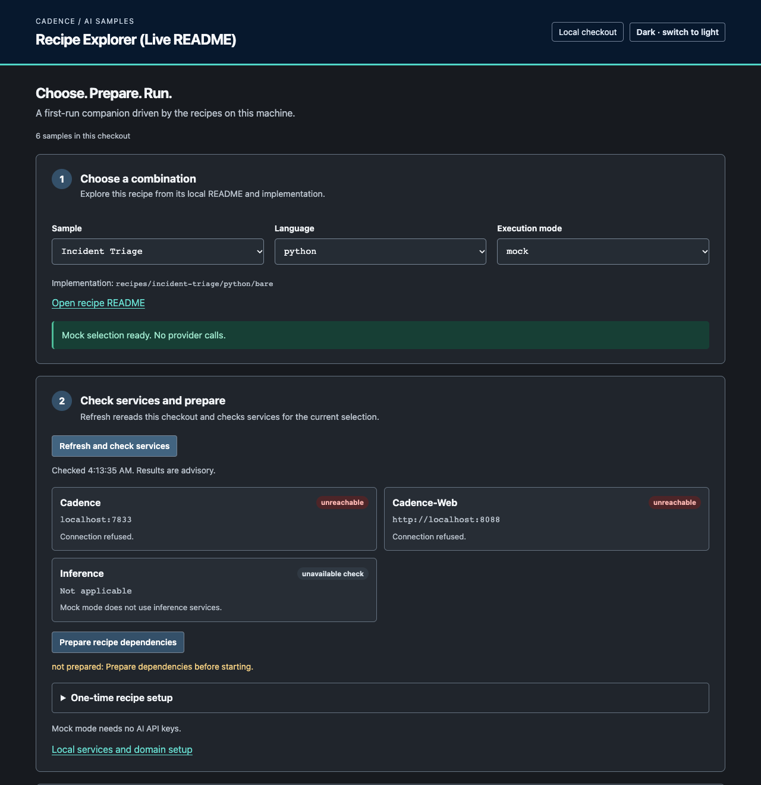

# Cadence Workflow ContribFest

Join Cadence maintainers at **Cadence Workflow ContribFest: Build Durable AI
Agent Examples** during KubeCon + CloudNativeCon North America 2026.

- **When:** Wednesday, November 11, 2026, 2:20-3:40 PM MST (80 minutes)
- **Where:** Salt Palace, Level 2, room 255 D, Salt Lake City, Utah
- **Session page:** [Cadence Workflow ContribFest: Build Durable AI Agent
  Examples](https://sessionize.com/s/diana-zawadzki/cadence-workflow-contribfest-build-durable-ai-agen/182913)
- **Event details:** [official KubeCon + CloudNativeCon North America
  schedule](https://events.linuxfoundation.org/kubecon-cloudnativecon-north-america/program/schedule/)
- **Event work:** [ContribFest
  milestone](https://github.com/cadence-workflow/cadence-ai-samples/milestone/2)

## Start with an outcome

Run a prepared agent, make one focused contribution and show what it enables.
You might recover an investigation after a failed call, prevent a duplicate
booking or give a reviewer a deadline. If you improve a test, show which
incorrect behavior it now catches.

New to Cadence? Use the [prepared mock-agent path](contribfest/kubecon-na-2026/README.md#new-to-cadence-start-here)
to see a draft before choosing a change. Then select work by purpose,
difficulty and setup in the [task selection page](contribfest/kubecon-na-2026/shortlist.md).

## Samples Explorer

Choose an agent recipe, get matching commands and see its execution in
Cadence Web. The Explorer reads your local checkout, including your edits.



| Start here when you want to | Use the Explorer to |
| --- | --- |
| Find an example to build on | Choose a recipe, language, framework and mock or live mode. |
| Get past local setup | Prepare dependencies and check which services respond. |
| Understand an agent Run | Open history and Queries, then send supported review Signals. |

From the repository root, launch the local browser tool:

```bash
./scripts/explore.sh
```

Browsing needs Python 3.10+ with venv support; the first launch downloads a
Python dependency. Each recipe has its own runtime and service requirements.
See [the Explorer walkthrough](contribfest/kubecon-na-2026/setup.md#explore-the-samples-in-your-browser)
for selection, setup, Run links and review Signals.

## Build durable AI examples

Start with Incident Triage to get familiar with the agent and Cadence. Inspect
an intentional lookup failure in Cadence Web, adjust its retry policy and
follow the agent as it continues with a real model.

Then work with a maintainer on an AI sample, a small workflow of your own or
another approved Cadence Issue. Most work will be in this repository. Leave
a useful change or a clear next step for the next contributor.

## Plan your session

- [What you'll work on](contribfest/kubecon-na-2026/README.md)
- [Set up your laptop](contribfest/kubecon-na-2026/setup.md)
- [Choose your next contribution](contribfest/kubecon-na-2026/shortlist.md)
- [Session outline](contribfest/kubecon-na-2026/agenda.md)

You do not need to claim an Issue to try the introductory exercise. Use the
claim process below when choosing an upstream contribution.

## Bring your own agent idea

[Propose an agent workflow](contribfest/kubecon-na-2026/shortlist.md#bring-your-own-workflow)
and demonstrate how it recovers from one failure. Start with a useful result,
such as a research briefing, a reviewed travel plan or a coding task. Describe
the external calls, failure and observable recovery in your own recipe issue.
Ask a facilitator to review the proposal and record your claim before upstream
implementation. Use synthetic data and provide a mock path so others can try it.

If you prefer a prepared task, claim its existing issue below instead of
creating a duplicate.

## Find a ContribFest Issue

Session candidates live on this repository under the
[ContribFest milestone](https://github.com/cadence-workflow/cadence-ai-samples/milestone/2)
and the `event:contribfest` label. Open, unassigned Issues labeled
`status:ready` are available to claim through the coordinator path below.
Recheck ownership and linked pull requests before claiming.

Choose a difficulty that matches your experience and what you want to learn.
The [task index groups prepared work by level](contribfest/kubecon-na-2026/shortlist.md#choose-your-level)
and separates the change's complexity from the tools and services it needs:

| Path | Good when you want to… |
| --- | --- |
| **Beginner** | Read one focused example and improve a test or a small, well-defined behavior. |
| **Intermediate** | Change retry, review or state behavior across a few functions and test its edge cases. |
| **Advanced** | Investigate persistent state, replay or recovery across multiple steps or Runs. |

Pick the task that fits you. Excited contributors should feel empowered to claim
a stretch Issue; maintainers are in the room to help. Claim through the
coordinator path below; do not open competing branches for the same Issue.

## Participant guide

### 1. Choose a workflow problem

Choose a useful outcome for an agent: produce a report, book a trip, route a
ticket or keep a release watch moving. Then choose one behavior to improve.
The issue explains what you will make possible, the Cadence concept it uses
and how you will observe the result.

Cadence coordinates retries, records completed Activity results and delivers
human input. Your application still defines valid input, safe repeated writes,
review rules and whether the result is useful. A passing Workflow alone does
not prove that an agent's answer is correct.

Each issue includes a short experiment and a dedicated resources section.
Predict the result, run the smallest relevant case and inspect its state or
output. For a coverage task, keep the existing runtime behavior and prove the
new test detects the documented mistake.

Prepare only the local services named by your Issue:

| Service | Use | Fast setup |
| --- | --- | --- |
| Cadence | Run and inspect the workflow | [Ticket Routing requirements](recipes/ticket-routing/README.md#requirements) |
| Laya | Local classification | [Install Laya](README.md#install-laya) |
| Ollama with `qwen2.5:7b` | Incident Triage live exercise | [Exercise setup](recipes/incident-triage/python/bare/exercises/retry_policy_live/README.md#prepare-before-the-session) |
| Ollama with `llama3.2` | Local model inference | [Install Ollama and llama3.2](README.md#install-ollama-and-llama32) |
| Full local example | Exercise Laya and `llama3.2` together | [Recurring AI Watch setup](recipes/recurring-ai-watch/README.md#setup) |

The selected Issue and recipe README are authoritative because language
versions, ports, and validation commands vary. Event candidates do not require
paid inference or provider credentials.

### 2. Claim one Issue

Choose an open, unassigned candidate from the organizer-published event pool.
Candidates use `event:contribfest`, the event milestone, and one setup lane.
Those markers group event work; the `status:*` label records whether work is
available or claimed.

Use the [first-time contributor
path](CONTRIBUTING.md#first-time-contributor-path) and its [approved-work claim
instructions](CONTRIBUTING.md#claim-approved-work). During the event, the claim
coordinator applies that workflow:

1. You choose an open, unassigned `status:ready` candidate.
2. You post the documented claim request with your GitHub username and proposed
   `issue-N-short-slug` branch.
3. The coordinator rechecks assignees, comments, labels, and active linked pull
   requests.
4. The coordinator records ownership and changes `status:ready` to
   `status:in-progress`.
5. Only then do you create the branch on your fork and begin work.

There is no informal event claim. If two people want the same Issue, wait for
the coordinator's ownership record rather than creating competing branches.

### 3. Plan, work, and validate

Use [Plan before building](WORKFLOW.md#plan-before-building), the
[contribution workflow](CONTRIBUTING.md), and, if applicable, the [coding-agent
contract](AGENTS.md).

- Humans working alone and humans using coding agents follow the same Issue
  scope, non-goals, and validation contract. Coding agents are optional.
- One writing contributor or agent owns an Issue at a time. Other helpers may
  investigate or review without creating competing edits.
- The human contributor owns decisions and DCO-signed commits.
- Run the candidate's focused offline checks before requesting review.
- Approval to start a first-time contributor's GitHub Actions workflow is not
  pull-request approval. Pull-request approval is not merge authorization.
  Architecture, priority, pull-request approval, and merge authorization stay
  with the designated humans.

Ask the in-room team for help, or join **`#cadence-contributors` on CNCF Slack**
for setup, task and review questions. [Sign up or sign in](https://slack.cncf.io/),
then search for `#cadence-contributors` and join the channel. Use the same
channel to continue the conversation after the session.

### 4. Finish or hand off

Show the result before handing it over: the receipt reused, the approval
expired, the calls not repeated or the test that catches a deliberate bug.
Include the observation in your PR or issue comment and say what it enables
in an application. Record only what you actually ran.

Choose the safe outcome that fits the remaining time:

- **Draft pull request:** create a DCO-signed commit on your fork branch, push
  it, and open a draft pull request with exact validation evidence.
- **Durable Issue handoff:** comment on the claimed Issue with the fork and
  branch, changed paths, exact commands and results, untested behavior,
  limitations, blockers, working-tree/commit/push state, exact next step, and
  next owner if known.

Unfinished work is expected. Do not rush an unsafe commit or pull request to
meet the session clock. Keep the Issue `status:in-progress` until merge, or use
the normal abandonment workflow only after preserving the current state.

## Troubleshooting

- **A local service is not ready:** Re-run the health or minimal-prompt check
  linked in the setup table. Share the command and exact output with event
  staff. Do not paste credentials.
- **Setup is taking too long:** Ask a helper. You can pair on a working laptop
  or choose work with fewer local requirements.
- **You cannot claim an Issue:** Post the documented claim request and ask event
  staff to record ownership and update the lifecycle label.
- **GitHub Actions is waiting for approval:** Stop and ask a maintainer to
  review the fork changes. Workflow-run approval is not pull-request approval.
- **A validation command fails:** Preserve the command, complete output, current
  branch, and changed paths. That evidence is still a useful handoff.
- **Internet access is unreliable:** Keep working from the prepared checkout
  and Issue notes. Do not create a competing claim; coordinate ownership with
  event staff before pushing when access returns.

## Related Cadence sessions at KubeCon NA 2026

Cadence week is built so you can pick a track (or more than one):

| Track | What you get |
| --- | --- |
| **See failure and recovery** | Inspect failure and repeated work, then see what Cadence preserves |
| **Build on AI samples** | Use [`cadence-ai-samples`](https://github.com/cadence-workflow/cadence-ai-samples), claim a ContribFest Issue, and extend a real recipe |
| **Make your agents durable** | Learn when an agent should become a Cadence workflow and how retries, history, and approvals hold under failure |
| **Contribute to Cadence** | Ship reviewable changes with maintainers in the room (this ContribFest), or talk shop at the project pavilion |

Official schedule:
[KubeCon + CloudNativeCon North America
2026](https://events.linuxfoundation.org/kubecon-cloudnativecon-north-america/program/schedule/).

| When (MST) | Session | Where | Fits |
| --- | --- | --- | --- |
| Mon Nov 9, 11:17-11:22 AM | **Secure Your Agents in 5 Minutes: Durable Execution with Cadence** (Diana Laura Zawadzki) | Hyatt Regency, Level 4, Regency BD | Make agents durable |
| Mon Nov 9, 3:20-3:45 PM | **Building and Maintaining Production-Ready SDKs with LLMs** (Ender Demirkaya, Shijie Sheng), Agentic Day | Agentics Day Room 1 | Contribute to Cadence |
| Tue Nov 10, 3:00-7:00 PM | **Meet the Cadence Maintainers**, Project Pavilion kiosk P-15B | Solutions Showcase, Level 1, Hall 5 | Contribute to Cadence |
| Wed Nov 11, 2:20-3:40 PM | **Cadence Workflow ContribFest: Build Durable AI Agent Examples** (Diana Laura Zawadzki, Shijie Sheng) | Salt Palace, Level 2, 255 D | Build on AI samples; contribute to Cadence |
| Thu Nov 12, 2:40-3:10 PM | **Agents Fail. Workflows Recover. Durable Agent Orchestration with Cadence** (Diana Laura Zawadzki, Shijie Sheng) | Salt Palace, Level 1, Ballroom ACE | See failure and recovery; make agents durable |
| Thu Nov 12, 3:30-4:00 PM | **Splitting the Monolith at Cloudera: Building Fault-Tolerant Workflows with Cadence** (Soma Koltai, Ender Demirkaya) | Salt Palace, Level 1, Ballroom BDF | Contribute to Cadence (production journey) |
