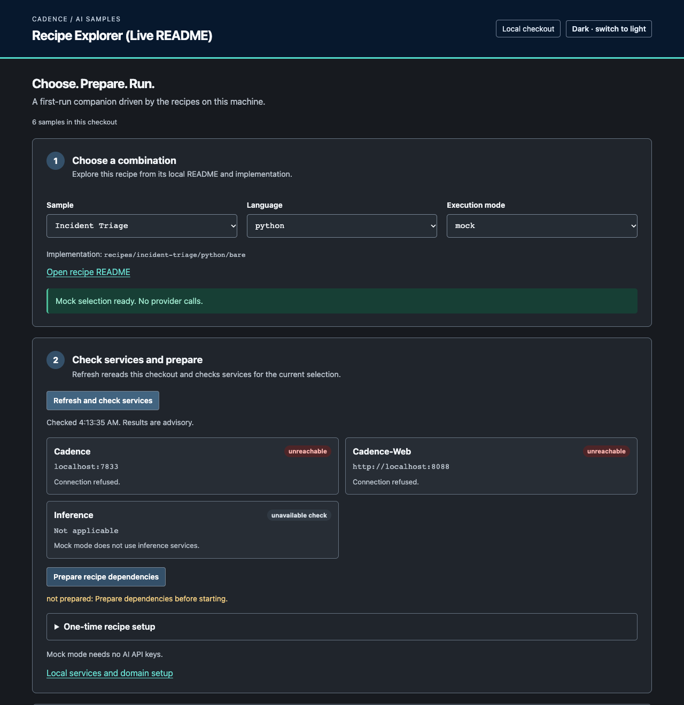

# Contributing

Build something useful. Start with a problem you want to solve.

## Explore the recipes in your browser

Building with agents? Use the [Samples Explorer](tools/explorer/README.md) to
find a working example, get matching commands and see what happens when it runs.
It reads your checkout, including local edits, so you can explore the recipe
while changing its code.



*Mock selection before the Cadence services are started. Connection checks show
which service needs attention; mock mode needs no inference service.*

| What you want to do | How the Explorer helps |
| --- | --- |
| Try an agent workflow | Pick a recipe and language, then a framework if one is offered. Use mock mode before downloading a model. |
| Get it running locally | Prepare dependencies, check services and copy matching Worker and Workflow commands. |
| Understand a Run | Open Cadence Web history and Queries; send supported review Signals with confirmation. |

From your [cloned checkout](#first-time-contributor-path):

```bash
./scripts/explore.sh
```

Browsing needs Python 3.10+ with venv support. The first launch downloads PyYAML
and opens `http://127.0.0.1:8765/`. You can browse before installing Cadence or a
model. Running a recipe needs the runtime and services listed in its README.

1. **Choose a recipe.** Select its language, then a framework if one is offered,
   and mock or live mode. Start with **Incident Triage**, **python**, **mock**;
   this recipe has no framework selector. That path uses scripted responses
   without a model download or API key. Preparing it needs Python 3.12 or 3.13;
   running it also needs Cadence.
2. **Prepare and check setup.** Use **Prepare recipe dependencies**, then
   **Refresh and check services**. For supported local live selections,
   **Warm up selected local services** sends a small request. It does not
   start services or download a missing model. Check the recipe README if a
   service or model is unavailable.
3. **Start your example.** Copy the generated Worker and Workflow commands
   into separate terminals. On macOS, **Open in Terminal** pastes a command
   for you to review and run. You start the services, Worker and Workflow.
4. **Follow the Run.** Use **Resolve latest run**, then **Open history** or
   **Open queries**. These links open Cadence Web. Queries need a running
   Worker. Resolve again after Continue-As-New to follow the new Run.
5. **Send review input.** Where the recipe offers Signal controls, enter the
   fields, select **Send …**, then **Confirm …**. The Explorer does not show a
   raw payload. Check a Query or history afterward to see how the Workflow
   handled it. Ticket Routing uses the
   [Acknowledge Ticket control](recipes/ticket-routing/README.md#cadence-web-cwc)
   in Cadence Web.

**Using a shared Cadence server?** Give your Worker and Workflow matching,
unique task-list names and choose your own Workflow ID. The Explorer's
**Resolve** and **Signal** controls follow only the Workflow ID it generates;
changing the copied command does not retarget those controls. Use Cadence Web
or the recipe CLI for a custom Workflow ID.

Stop the Explorer with Ctrl+C. If its port is busy, use
`./scripts/explore.sh --port 0`. The
[Explorer runbook](tools/explorer/README.md) covers its controls and limitations.
For ContribFest, continue with [laptop setup](contribfest/kubecon-na-2026/setup.md)
and [available tasks](contribfest/kubecon-na-2026/shortlist.md).

### If a connection check fails

| What you see | What to check next |
| --- | --- |
| Cadence or Cadence Web is unreachable | Start Docker if your setup uses it. Check `docker ps` for the containers and published ports, then follow the recipe's service setup. Refresh the checks afterward. |
| Cadence is reachable but the Workflow does not progress | Confirm the domain exists and a Worker is polling the same task list. A successful connection check does not verify either. |
| A local model request fails | Check the selected model is installed with `ollama list` and use its documented `ollama pull` command if missing. Warm-up does not download models; some recipe selections have no model health check. |
| A Query times out | Check the Worker is running and that Cadence Web points to the correct domain and Workflow. |

The Explorer helps you locate the problem; the
[recipe runbook](README.md#run-a-recipe) supplies the service setup and commands.

## First-time contributor path

Fork [cadence-ai-samples](https://github.com/cadence-workflow/cadence-ai-samples)
on GitHub, then clone your fork. Replace `YOUR-USERNAME` with your GitHub username:

```bash
git clone https://github.com/YOUR-USERNAME/cadence-ai-samples.git
cd cadence-ai-samples
```

You can browse and run samples before claiming work. To contribute a change,
choose an approved Issue using the steps below.

Your fork and the canonical repository have different roles:

- `origin` is your contributor fork. Create and push implementation branches
  there.
- `upstream` is `cadence-workflow/cadence-ai-samples`. Issues, approvals, and
  pull-request targets live there.

Run `git remote -v` before starting. If the canonical repository is missing, add
it with:

```bash
git remote add upstream https://github.com/cadence-workflow/cadence-ai-samples.git
```

Every open Issue has exactly one lifecycle label, and it tells you what you may
do:

- `status:needs-triage` means proposed work. It is not claimable, so do not
  self-assign or implement it.
- `status:ready` means a maintainer approved the work. It is claimable only
  when it has no assignee, claim comment, or active linked implementation PR.
- `status:in-progress` means the work is already claimed. Do not start a
  competing implementation.

Assignment records ownership of approved work, not interest or priority. Only a
human maintainer may transition a proposal to `status:ready`. Moving between
states replaces one lifecycle label with another. A repository guard returns an
open Issue with no lifecycle label, several lifecycle labels, or a
`status:ready` label set by anyone else to `status:needs-triage`.

`format:human-first` and `format:agent-first` describe presentation, not
eligibility or ownership. Either format may be claimed by a human or implemented
with a coding agent. Missing format or classification labels never make work
claimable.

### Find and plan work

1. Find an open upstream `status:ready` Issue.
2. Check its assignee, comments, and linked PRs. Do not take work owned by
   someone else.
3. Follow [Plan before building](WORKFLOW.md#plan-before-building). Review the
   assumptions, dependencies, scope, non-goals, validation, and decisions that
   need maintainer authority before claiming or editing.
4. Recheck the Issue immediately before claiming it.

If no claimable Issue exists, do not self-assign a `status:needs-triage` Issue.
For plain `Capture this idea`, first decide whether this is general idea intake
or an implementation task. General ideas remain format-neutral. For a defined
implementation task, choose human-first or agent-first before drafting, then
follow the matching permission-aware path.
Outside contributors should use the repository
[Issue forms](https://github.com/cadence-workflow/cadence-ai-samples/issues/new/choose)
and choose:

- **General work proposal** for format-neutral idea intake that still needs
  maintainer triage before implementation-task authoring.
- **Human-first work proposal** for a defined implementation task with an
  approachable starting state, observable gap or failure, exact edit and
  validation paths, and a useful 45-minute stopping point.
- **Agent-first work proposal** for a defined implementation task expressed as
  a detailed durable contract with context, scope, decisions, acceptance
  criteria, validation, limitations, and handoff.
- **Recipe proposal** for specialized new-recipe or port intake. Recipe intake
  remains format-neutral until maintainer triage.

The forms apply only their configured initial labels, including
`status:needs-triage`. General and recipe intake add no format label; the two
implementation-task forms add their matching `format:*` label. Maintainer
triage applies any missing `source:agent`, format, type, area, or other
classification labels.

Maintainers and contributors with upstream label permission may instead use the
[agent-first-only labeled CLI proposal
path](agent-context/README.md#creating-a-proposal). An agent without that
permission prepares the proposal for human form submission or requests
maintainer assistance; it must not run the labeled command. Then wait for a
human maintainer to transition the proposal to `status:ready`.

### Claim approved work

If you can update the upstream Issue, comment your intent with your GitHub
username and proposed branch, replace `status:ready` with
`status:in-progress`, and then create an `issue-N-short-slug` branch on your
fork. The claim comment and `status:in-progress` together record your ownership.

If you cannot change upstream labels or assignment, post this comment:

> I would like to claim this approved Issue. Proposed branch:
> `issue-N-short-slug`. I cannot change upstream labels or assignment.
> Maintainer, please record me as the owner and change `status:ready` to
> `status:in-progress`.

Do not create the branch or begin implementation until the upstream Issue has
`status:in-progress` and identifies you as the owner through either assignment
or a maintainer comment confirming the claim.

### Complete and hand off the work

1. Work on the Issue branch, then post and verify the local-completion evidence
   required by [AGENTS.md](AGENTS.md) before calling it ready for review or commit.
2. Follow the contributor's commit policy. Every commit requires DCO sign-off
   with lowercase `git commit -s`, regardless of who creates it.
3. After the signed commit is pushed, open a draft PR against
   `cadence-workflow/cadence-ai-samples:main`.
4. The root PR template is the automatic human-first default. To use the
   detailed agent-first format, run
   `gh pr create --template .github/PULL_REQUEST_TEMPLATE/agent-first.md ...`
   or open
   `https://github.com/cadence-workflow/cadence-ai-samples/compare/main...<owner>:<branch>?expand=1&template=agent-first.md`.
   GitHub does not automatically display a template chooser.
5. Link the Issue and include actual test commands/results, untested behavior,
   and known limitations.
6. Follow the applicable human review path below, then wait for explicit
   repository-owner merge authorization. A coding agent cannot approve a PR or
   supply merge authority.

Keep claimed work `status:in-progress` until merge closes the Issue. If
abandoning it, comment the reason and current state, ask a maintainer to replace
`status:in-progress` with `status:ready`, and ask before deleting the
branch. Branch names identify the Issue, not the coding tool, because work may
move between agents.

## Review and merge policy

A non-owner PR requires one approval from a human member of the existing
`cadence-dev` team. A new commit dismisses prior approvals, so a fresh
`cadence-dev` approval must cover the current head. Approval to run a first-time
contributor's workflow is a separate safety gate and does not count as PR
approval.

The repository owner, `Bueller87`, cannot approve an owner-authored PR through
GitHub self-review. Until another eligible approver is available, the owner may
use the pull-request-only review bypass on an owner-authored PR and must record
that use in the PR. GitHub technically makes the bypass available on non-owner
PRs too, but repository policy forbids using it there.

The owner exception applies only to the human review gate. Every PR still needs
passing `DCO`, `Scripts and profile contracts`, and `Explorer Python` checks on
a head that is current with `main`, and all review threads must be resolved.
Those gates are enforced in a separate ruleset with no bypass actors. Routine
direct pushes to `main` and required-check bypasses are prohibited.

Human review approval and repository-owner merge authorization are separate.
Only the repository owner may authorize a merge. An agent may execute an
authorized merge only after verifying the applicable review path, all required
checks, branch currency, and resolved threads.

For a real incident, the repository owner may change a ruleset only after
recording the reason and current state in an Issue. Record the before/after
configuration and restoration in that Issue. Do not weaken rules routinely.

## Offline pull-request checks

The baseline GitHub Actions workflow uses Ubuntu and Python 3.12. It runs the
scripts, generator, launcher, and profile contract suite and the Explorer Python
suite on pull requests to `main` and pushes to `main`.

To run the matching checks from the repository root, use Python 3.12 and prepare
the scripts and Explorer environments before running their suites:

```bash
python3 -m venv scripts/.venv
scripts/.venv/bin/python -m pip install -r scripts/requirements-test.txt
scripts/.venv/bin/python -m unittest discover -s scripts/tests -v
python3 -m venv tools/explorer/.venv
tools/explorer/.venv/bin/python -m pip install -r tools/explorer/requirements.txt
tools/explorer/.venv/bin/python -m unittest discover -s tools/explorer/tests -v
```

A workflow run from a first-time outside contributor's fork may pause for
maintainer approval. If GitHub shows that the run is awaiting approval, wait for
a maintainer. Do not rerun it, change workflow files to try to start it, or
assume that the checks have begun. A maintainer reviews the fork diff before
clicking **Approve workflows to run**.

In the observed first-time fork test, the initial run paused, and a corrected
push to the same unmerged pull request paused again. This describes only that
account before any of its contributions had merged. It does not predict what
GitHub will do after a contributor's first merged contribution.

These checks do not:

- install per-recipe dependencies or run each recipe's test matrix;
- test Go, Java, Python 3.13, or the Explorer jsdom workflow;
- start Cadence, Cadence-Web, Laya, Ollama, a live model Worker, or paid
  inference;
- use repository or provider secrets; or
- make themselves required checks or change branch rules. That policy work is
  tracked in [Issue #78](https://github.com/cadence-workflow/cadence-ai-samples/issues/78).

## Testing a recipe

Start with the recipe README and run its documented tests before changing code.
Root pull-request checks do not run the recipe suites. For ContribFest, the
[Issue](contribfest/kubecon-na-2026/shortlist.md) names the implementation and
required services; use [event setup](contribfest/kubecon-na-2026/setup.md) for
local Cadence and models. Unit-test tasks may need neither service.

Add a regression test that fails on the original behavior and passes with your
change. Keep both results for the PR. For a test-only task, temporarily introduce
the bug the test should catch, run the test, then undo that temporary change.
Do not include the deliberate bug in your PR.

### Cadence references

Read the relevant concept, then use the recipe to check the behavior:

- **Retries:** [Python](https://cadenceworkflow.io/docs/python-client/retries/)
  and [Go](https://cadenceworkflow.io/docs/go-client/retries/). Check that a
  temporary error can recover and a permanent error stops. The application
  classifies its errors; the Activity retry policy uses that classification.
- **Signals:** [Python](https://cadenceworkflow.io/docs/python-client/signals/)
  and [Go](https://cadenceworkflow.io/docs/go-client/signals/). Send review or
  guidance to a running Workflow and check its resulting state.
- **[Queries](https://cadenceworkflow.io/docs/concepts/queries/):** inspect
  Workflow state without changing it. Queries need a running Worker.
- **[Timers](https://cadenceworkflow.io/docs/concepts/timers/):** test both an
  on-time approval and expiry when no approval arrives.
- **[Activities](https://cadenceworkflow.io/docs/concepts/activities/):** for a
  write with a lost reply, check that repeating the call does not repeat the
  side effect.
- **[Go replay](https://cadenceworkflow.io/docs/codelabs/workflow-tests-go-replayer-shadower/):**
  replay a recorded history to check Workflow compatibility. A mocked Workflow
  test alone does not establish replay compatibility.

### Test environment details

The SDK testing guides cover
[Python](https://cadenceworkflow.io/docs/python-client/testing/) and
[Go](https://cadenceworkflow.io/docs/go-client/workflow-testing/). In these recipes:

- Python's `TestWorkflowEnvironment` does not retry Activities. Assert the
  configured retry options in unit tests; use local Cadence to count attempts.
  Go's `testsuite` does apply the retry policy.
- Python virtual time can advance to a pending timer when the Workflow blocks.
  Check Signal tests when adding an approval deadline.
- Python `non_retryable_error_reasons` matches the exception class name.
  Set `backoff_coefficient` explicitly, following the recipe's existing policy.
- Incident Triage's `durability-lines.json` pins line ranges in `workflow.py`
  and `raw_agent.py`. If your change moves those lines, update the manifest and
  run `.venv/bin/python durability_manifest.py` from the implementation directory.
- Mock state can persist in `.state/`. Use fresh state for independent tests;
  preserve it when testing recovery or duplicate writes.

For a running example, follow the recipe README. The
[Samples Explorer](tools/explorer/README.md) helps you browse recipes, prepare
commands, inspect Runs and send supported Signals. On a shared Cadence server,
use your own task list for both the Worker and Workflow start.

### Run your own Worker

A [Worker](https://cadenceworkflow.io/docs/python-client/workers/) is the
process that runs your Workflow and Activity code. Cadence only gives work to
Workers polling the task list the Workflow was started on. The
[Go client](https://cadenceworkflow.io/docs/go-client/workers/) uses the same
idea. If the Worker stops, the Workflow stays stuck, and a Query can time out.

Use the same task list when starting the Worker and Workflow. On a shared
server, choose a name unique to you. In the Python recipes, global flags go
**before** the subcommand:

```bash
./run.sh --task-list <you>-triage worker --mode mock
./run.sh --task-list <you>-triage --workflow-id <you>-1 start --mode mock
```

Run these in separate terminals from the implementation directory. Go recipes
put flags **after** the subcommand instead; follow their README.

### Find your Run in Cadence Web

For a local server, open
`http://localhost:8088/domains/cadence-ai-samples/cluster0/workflows/<workflow-id>`.
The recipe prints its Workflow ID. Select the Run to inspect its history.
Use the **Queries** tab to run the recipe's status Query. Queries need a running
Worker, including while a Workflow waits for approval. A recorded Signal means
Cadence accepted it; inspect history or the resulting state to check processing.

### Cadence CLI

The [Cadence CLI](https://cadenceworkflow.io/docs/cli/) can describe a Run and
export its history. The documented local setup already installs that CLI on
the host. Use it directly:

```bash
cadence --domain cadence-ai-samples workflow describe -w <workflow-id>
cadence --domain cadence-ai-samples workflow show -w <workflow-id> --of history.json
```

`workflow show` writes `history.json` in the current directory. There is no
container copy step.

The Cadence compose file does not set `container_name`, so the server container
is usually `docker-cadence-1`, not `cadence`. `docker exec cadence` then fails
with "No such container: cadence". If you need the CLI inside the container,
find the name first:

```bash
docker ps --format '{{.Names}}'
docker exec <container-name> cadence --address cadence:7933 --domain cadence-ai-samples workflow describe -w <workflow-id>
```

## DCO and licensing

The required lowercase `git commit -s` sign-off certifies that the contributor
has the right to submit the contribution under the Developer Certificate of
Origin (DCO). The repository's [Apache License 2.0](LICENSE) governs use,
modification, and distribution of the repository.

## Coding-agent contributions

Agent-assisted changes follow the same Issue, branch, PR, review, and validation
requirements as human-written changes. Coding agents must begin with
[AGENTS.md](AGENTS.md) and the
[repository context map](agent-context/README.md). The
[contribution workflow cheat sheet](WORKFLOW.md) maps short intent phrases to
these gates. Agents may create upstream `status:needs-triage` proposals but may
not approve priority or architecture, approve PRs, or authorize merges. Agents
without upstream label permission prepare an Issue-form submission or ask a
maintainer to file it.

## Recipe contributions

Before implementation:

1. Describe the proposed use case and why durable workflow orchestration helps.
2. Run `./scripts/new-recipe.sh your-recipe-name --language python --classifier none --agent none`
   (or another implemented profile from `./scripts/new-recipe.sh --help`), then
   tailor its `SPEC.md`. To add another implementation profile to an existing
   recipe without changing recipe-owned root files, use
   `./scripts/add-recipe-implementation.sh --help`.
3. Define how the recipe can be exercised with mock or synthetic data without paid AI API access.

When implementing a recipe:

- Keep it independently runnable and free of dependencies on other recipes.
- Keep workflow and Activity code easy to copy into another project.
- Include a README that explains how to run the recipe, what it does, and what users should expect.
- Include mock or synthetic test data that contains no real customer information or proprietary data.
- Keep credentials, secrets, and environment-specific configuration out of the repository.
- Do not use employer-owned code, internal documentation, proprietary configurations, credentials, or other non-public assets.
- Avoid unnecessary abstractions, shared integration layers, and premature refactoring.

Modularization is optional. A workflow, its Activities, and related business logic may remain together in one file when that is the clearest presentation.

When changing a generated profile or its contract, run the generator and
Explorer suites documented in
[`templates/profiles/README.md`](templates/profiles/README.md), plus the
profile's generated offline tests. Keep its `SPEC.md` fields, README and setup
commands, catalog names, credential environment-variable names, and actual CLI
in sync. Live inference changes also need an offline safe-endpoint mutation test
that reaches the selected transport without making a provider call.
