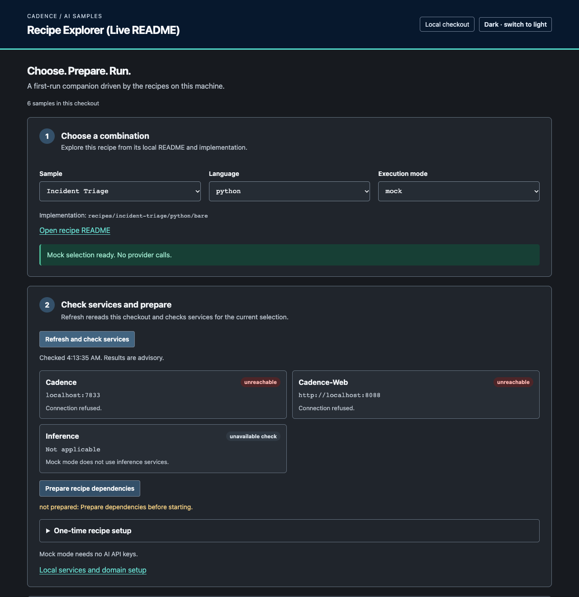

# Build Durable AI Agent Examples

Join Diana Zawadzki, Shijie Sheng and Cadence maintainers at KubeCon +
CloudNativeCon North America 2026.

- **When:** Wednesday, November 11, 2:20 to 3:40 PM MST
- **Where:** Salt Palace, Level 2, room 255 D, Salt Lake City

## Try the Samples Explorer

Start with the [Samples Explorer](../../tools/explorer/README.md) to choose
an agent recipe, prepare its dependencies and follow a Run in Cadence Web.
It reads your local code, including your edits, and gives you matching Worker
and Workflow commands.



*Browse first, then start the services your recipe needs. Here the checks show
that Cadence and Cadence Web are not running.*

From the repository root:

```bash
./scripts/explore.sh
```

You can browse with Python 3.10+ and venv support, before installing Cadence or
a model. The first launch downloads a Python dependency. See
[setup](setup.md#explore-the-samples-in-your-browser) for requirements.

Use it to:

- **Choose an example.** Select a recipe, language, framework and mock or live
  mode. The Explorer generates commands for that implementation.
- **Prepare and check your setup.** Install the recipe's dependencies with
  **Prepare recipe dependencies**, then use **Refresh and check services**.
  For a local live model, **Warm up selected local services** checks a small
  request before you start the Workflow.
- **Run your code.** Copy the Worker and Workflow commands into separate
  terminals. On macOS, **Open in Terminal** pastes a command for you to review
  and run.
- **Follow a Run.** Use **Resolve latest run**, then **Open history** or
  **Open queries** to inspect it in Cadence Web.
- **Send review input.** Recipes with Signal controls let you send guidance,
  request a revision or approve a result. Check the Run's state afterward to
  see how it handled your input.

For a first try, choose **Incident Triage**, **python**, **mock** (this recipe
has no framework selector) and follow
the [recipe runbook](../../recipes/incident-triage/README.md). Mock mode uses
scripted responses and needs no model or API key. Running the Workflow still
needs Cadence; the Run links need Cadence Web. The Explorer prepares recipe
dependencies, but you start the services, Worker and Workflow yourself.

## What you'll do

**Bring your own workflow and make it durable.** Bring an agent or script you
already run that makes at least one model or tool call. By the end, it runs
as a Cadence Workflow and survives the failure you're most worried about.

**1. Warm up together (about 20 minutes).** Incident Triage is an AI agent
investigating a fictional checkout outage with a real local model.

- **See it fail:** a log lookup gets an HTTP 429 rate limit, and with no retry
  policy the agent stops before it starts reasoning.
- **First win:** you add a [Cadence Activity retry policy](https://cadenceworkflow.io/docs/python-client/retries/), in one file. Run it
  again: the lookup waits, retries and the agent carries on. No retry loop in
  your code.
- **Handle a permanent failure:** in this exercise, a 404 is non-retryable, so retrying it only
  wastes time. Your policy must stop it after one attempt. Check both outcomes
  in Cadence Web.

Instructions:
[retry-policy exercise](../../recipes/incident-triage/python/bare/exercises/retry_policy_live/README.md).

**2. Make your own workflow durable (the rest of the session).**

1. Wrap: run your agent inside one [Activity](https://cadenceworkflow.io/docs/concepts/activities/), started by a [Workflow](https://cadenceworkflow.io/docs/concepts/workflows/).
   Every run, input, result and retry shows up in Cadence Web.
2. Split: move the model call and each tool call into their own Activities,
   so each one retries on its own and finished work isn't redone.
3. Steer (stretch): add a [Signal](https://cadenceworkflow.io/docs/python-client/signals/) so a person can approve or redirect.

Stop at any depth. Start from [#118](https://github.com/cadence-workflow/cadence-ai-samples/issues/118): open your own Issue for your
workflow, so someone can continue it if you don't finish. Steps are in
[Find something to work on](shortlist.md#bring-your-own-workflow).

**Want to explore first?** [#119](https://github.com/cadence-workflow/cadence-ai-samples/issues/119): break a running agent on purpose
(stop the worker, send a Signal mid-run) and file what surprised you.

**Didn't bring one?** Take a ContribFest Issue:

| Issue | What you'll do | Level | Needs a model |
| --- | --- | --- | --- |
| [#110](https://github.com/cadence-workflow/cadence-ai-samples/issues/110) | Prove `revise` reuses evidence and `guidance` investigates again | low | no |
| [#112](https://github.com/cadence-workflow/cadence-ai-samples/issues/112) | Make the recipe's clean-copy check pass | low | no |
| [#121](https://github.com/cadence-workflow/cadence-ai-samples/issues/121) | Prove a lost reply doesn't save the conclusion twice | low | no |
| [#111](https://github.com/cadence-workflow/cadence-ai-samples/issues/111) | Show a model call recovering from a rate limit | mid | yes |
| [#120](https://github.com/cadence-workflow/cadence-ai-samples/issues/120) | Let an unanswered approval expire on a durable timer | mid | yes |
| [#109](https://github.com/cadence-workflow/cadence-ai-samples/issues/109) | Help a small local model name the root cause | mid | yes |

A merged fix, a draft pull request or a written next step are all good
outcomes. You can work by hand or with a coding agent. If you use an agent,
start it with the repository's [agent instructions](../../AGENTS.md).

## Get ready

- [Set up your laptop](setup.md).
- [Find something to work on](shortlist.md).
- [See the session outline](agenda.md).

Ask a maintainer if you get stuck or want help choosing a task. The
[participant guide](../../CONTRIBFEST.md) covers claiming Issues, sign-off and
review.
